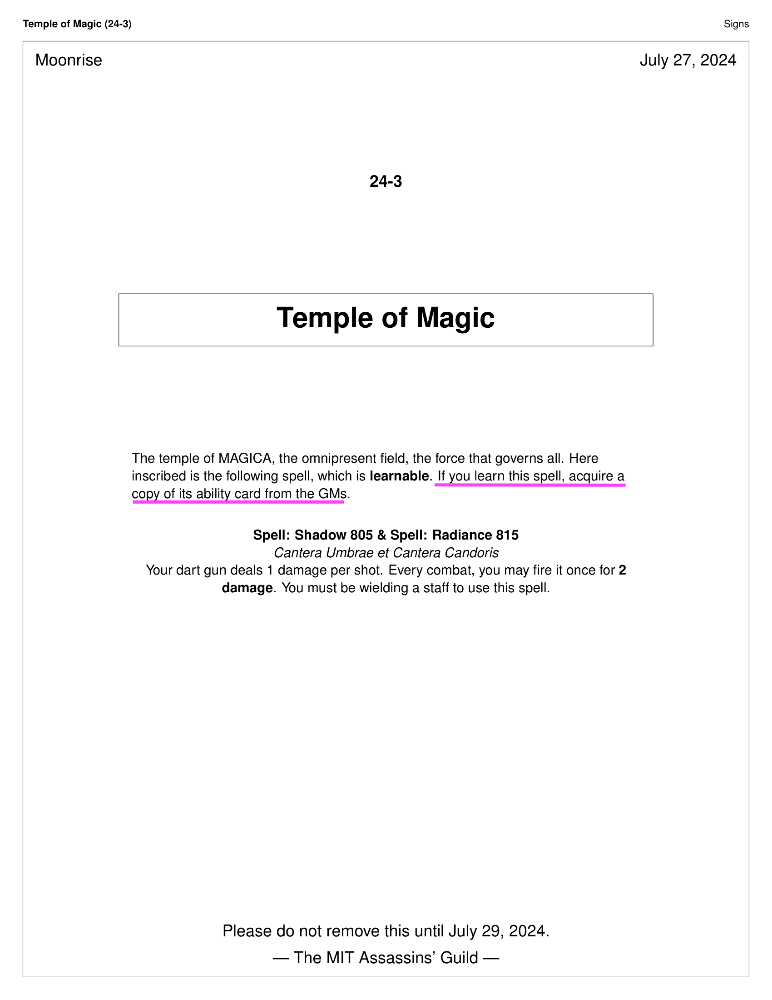
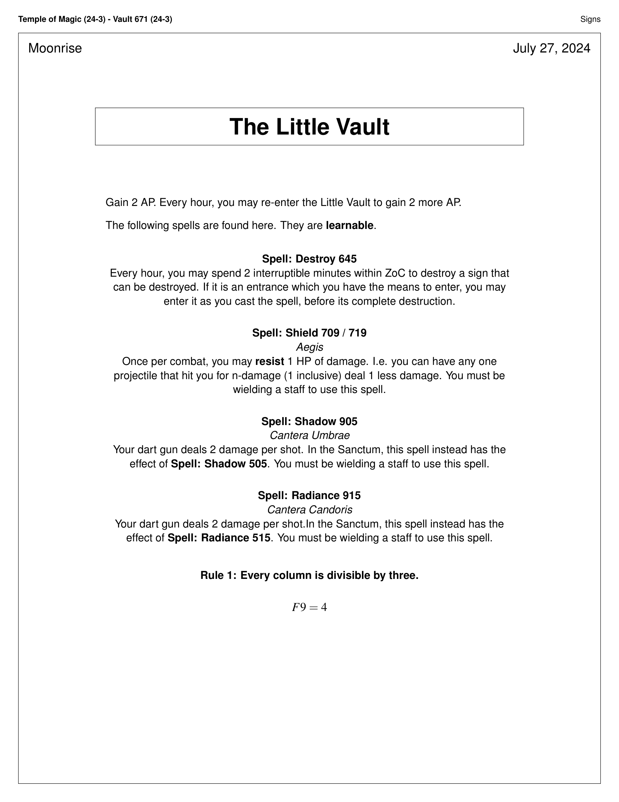
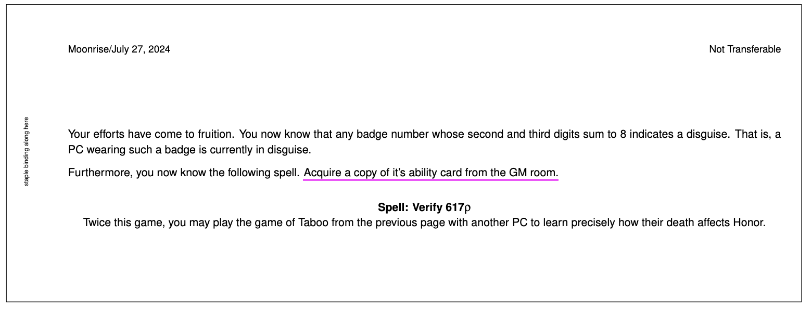
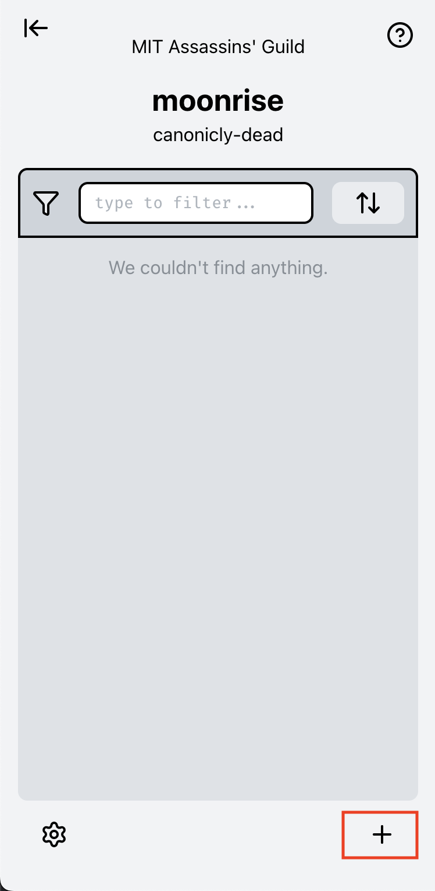
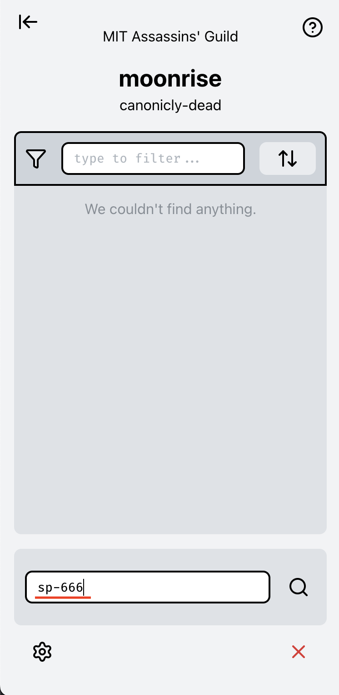
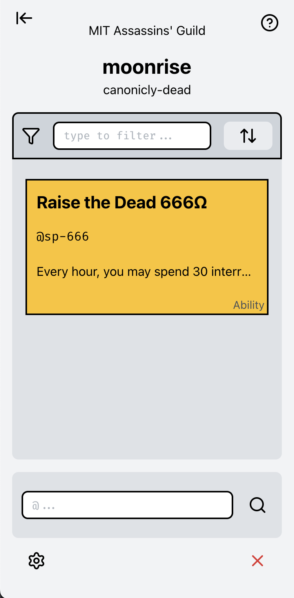
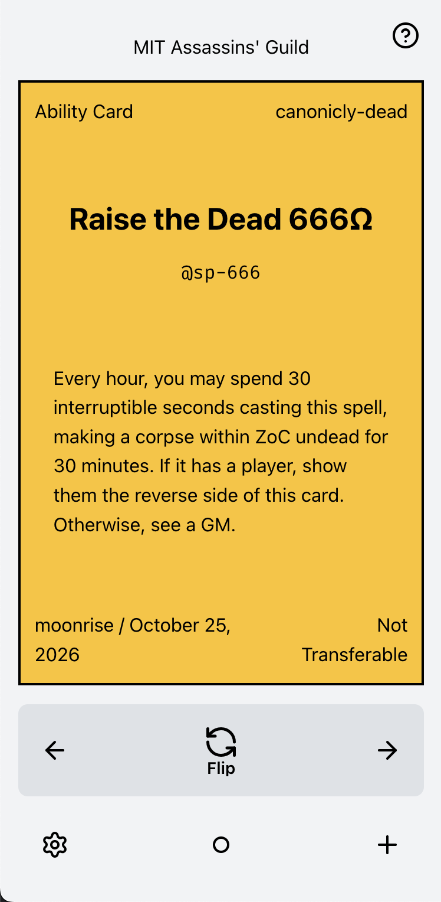
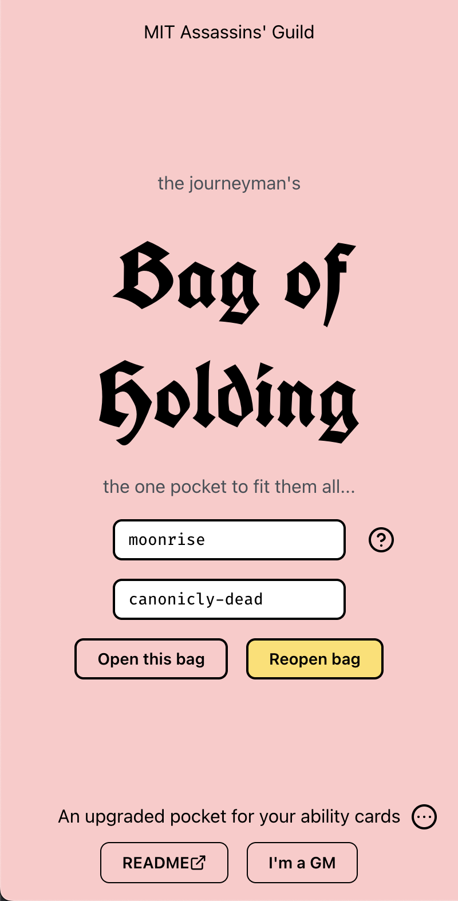

# Bag of Holding <sub>6.1040</sub>

_Tired of holding 50 pieces of paper in your sweaty hands and emptying out four pockets worth of stuff just for that one elusive ability card you really wished you knew where you put? Fear no more. The Wizard of the Court hath forth with an offering. A Bag of Holding, if you may. The price, you ask? Only that you use your powers for good and **never for evil.**_

---

Live action roleplay (LARP) claims its standing as a one-of-a-kind genre in the cosmos of games. LARP games put you right into their world, physically, using a combination of cleverly demarcated real-life spaces and the vast remainder of your imagination. Here at [MIT Assassins' Guild](https://assassin.mit.edu/web/Who_are_we%3F), our signature LARP style is the information-dense, mechanics-heavy "secrets & powers" games. These games can feature a novel's worth of text, with up to hundreds of items, player abilities, puzzle clues, etc. Traditionally, game pieces like abilities are packaged as card-sized physical cutouts, which have not only been labor intensive to produce, but also adversarial to pocket space and difficult to inventory. Puzzle clues are even more laborious, often requiring a player to manually copy the clue text into their notes. This can get frustrating, especially when a game is ten days long...

**Bag of Holding (BoH)** is a digital assistant that inventories a player’s out-of-game documents and stores them in an accessible digital pocket, eliminating the tedium of physical cutouts while fully preserving the "GameTeX ability card" look. Primarily player-facing, BoH is designed for mobile devices smaller than an iPad, with a complementary wide-screen dashboard for GMs to upload game information.

Here in this wonderous Bag, you can:

- **Collect** the goodies you find in game by entering their _lookup code_ and retrieving a digital copy of your rewards! They stay with you as long as you log back in with the same player name.
- **Filter** your abilities by name and description! See them all in a list so you can find them fast!
- **Display** any of your abilities as a card on your screen, which you can flip over and show other players just like you would normally!

And for you lovely GMs:

- All you have to do is create a game and upload your abilities into the Bag with whatever lookup codes _you_ designate so our behind-the-stage magic can find them again in the demiplane when your players ask!

\*Note: batch uploads from [GameTeX](https://web.mit.edu/kenclary/Public/Guild/GameTeX/) will (aim to) be supported if Ken Clary has time in the next three weeks.

## 0.0.1 Version Notes

This is the launch version of BoH, with fully functional player and GM interfaces supporting the Ability card type and player management. The player interface supports retrieving and displaying abilities. The GM interface supports GameTeX-rendering ability entries, batch uploading ability lists in JSON format, and deleting abilities. While we do not endorse the use of AI, an LLM would suffice to parse an `abil-LIST.tex` or `abil-PRINT.pdf` into the desired upload format.

Changelog:

- Functionality
  - \[GM] Playerlist, and the ability to remove players
- UI
  - \[Player] Merged display interface buttons into navigation bar
  - \[Player] Can change the color of ability cards

**Demos**

- [v0.0.1 demo]()
- [Beta demo]()
- [Alpha demo]()

## Why the Bag? <sub>User Journey</sub>

So you might have encountered a sign that told you this:



Or this:



Or maybe when you had finally completed your glorious evolution and opened the last page of your notebook...



You're 3 buildings away and busy unlocking the powers of the universe, thank you very much.

But now, armed with your personalized Bag of Holding, this is what your trip to the GM room looks like:

**Step 1: Click button**



**Step 2: Enter lookup code**



**Step 3: Profit**

<p>


</p>

Notice how you did 0 walking and got ahold of your cookie much, much faster? All you need is your phone and the internet, which lucky for you is supported everywhere at MIT!

The Bag is super easy to acquire. It's completely free, unlike all those MacGuffins you have to battle your opponents for. Just pop over to [bagofholding.mit-sdg.dev](https://bagofholding.mit-sdg.dev/#/), type in a (GM provided) game code, pick any name you choose, and the Bag is yours!



[I'm a GM, how do I set this up?](/documentations/GM-guide.md)

## [For Developers] Project Documentation

Bag of Holding is a webapp! It was built with several things:

- Frontend: [React 19](https://react.dev/), [Mantine UI](https://mantine.dev/), & [Motion](https://motion.dev/) (formerly Framer Motion)
- Backend: [Sync Engine](https://github.com/mit-sdg/sync-engine), [Bun](https://bun.com/)
- Database: [MongoDB](https://www.mongodb.com/)

Necessary Software:

- Bun v1.4.2
- Podman
- Compose

**AI Disclosure:** Except for 3 test cases in `./tests/Integration.test.ts`, Bag of Holding was not created using generative AI.

### Setting Up

Install Bun and set up MongoDb to run in a local container via [this guide](https://61040.github.io/fa26/preps/mongodb/). Inject the `MONGO_URL` into your local environment.

Clone this repository:

```
git clone git@github.com:s1lk-77/boh-1040.git
```

Run the `dev` command to enter dev mode and view your changes locally in a browser:

```
bun run dev
```

Run the `test` command to run all tests:

```
bun run test
```

To test that your MongoDb connection is functioning, run:

```
bun db:check
```

This runs the script in `scripts/check-db.ts`.

### Repository Structure

```
/
|- README.md
|- documentations/
|  |- testing/
|  |- ui-ux/
|  |- images/
|  |  |- ...
|  |- concepts/
|  |  |- concept-designs.md
|  |  |- ...
|  |- GM-guide.md
|  |- HLDD.md
|- design/
|- src/
|  |-main.tsx
|- web/
|  index.html
|  |- src/
|  |  |  |-main.tsx
```

- Sync Engine's required design files are in `design/`. Their implementations live in `src/`, whose entry point is `src/main.ts`.
- React's entry point is `web/src/main.tsx`. `web/src/ClientProvider.tsx` supplies the Sync client in a custom hook. All other components live in subdirectories with pages in `web/src/pages` and custom hooks in `web/src/hooks`.
- Constants and type declarations are in `shared/` (see Technical Design).
- The global CSS file is `web/styles.css`, and all other CSS files are in `web/src/assets/`.
- Tests are in `tests/`. See [test documentations](./documentations/testing/testing-README.md).

### High Level Design Doc

[Problem Framing](/documentations/HLDD.md)

### Technical Design

Bag of Holding is built on the Card data structure. Every game piece uses an interface that inherits from `BaseCard`, which contains a `MYlookup` field and a `MYname` field. Fields are named per GameTeX conventions and, where applicable, using their GameTeX names. The aim is for the GM interface to store lists of cards categorized by card type. The whole interface should feel reminiscent of the GameTeX repository.

Ideally in the future, adding a card type to Bag of Holding would become as simple as declaring a new type, and all of Editor, Viewer, Catalog, Uploader, and the end points themselves would be parameterized off of card type. Currently, only the catalog is, and the next few version updates will focus on implementing an overlying architecture to modularize card type creation.

Sync Engine concepts are documented in the [Concept Designs](documentations/concepts/concept-design.md) directory.

### UI/UX Design

See [UI Documentations](documentations/) and the files within.
