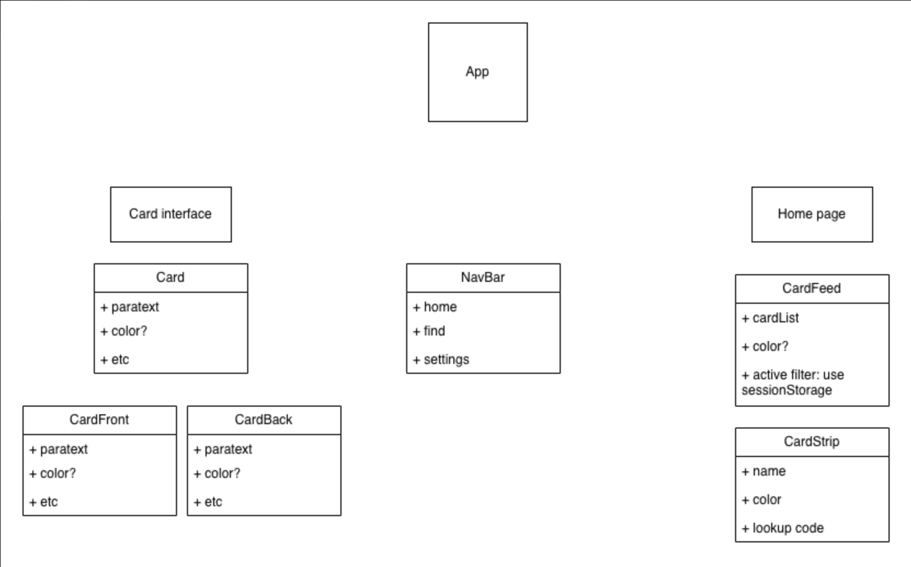
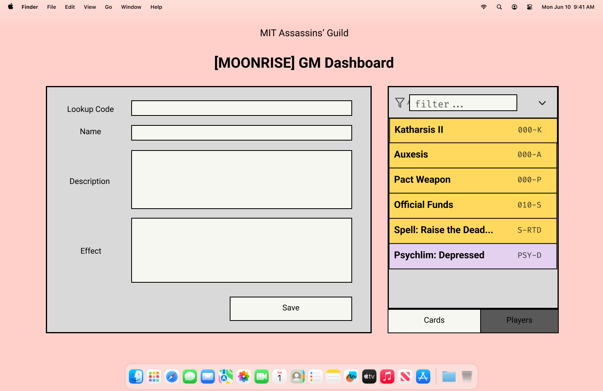
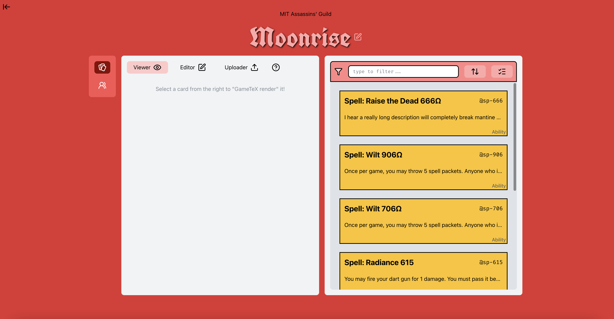

# v0.0.1 Design Summary

From dreaming up this app many months ago to throwing around ideas with Assassins' Guild to finally getting my hands dirty in 6.1040 to seeing Bag of Holding live on the internet has been an immeasurably fulfilling rollercoaster ride. To have one of the GMs for our upcoming game tell me she'd like to try out this app after playing with it for five minutes in the Banana Lounge was beyond rewarding.

Surprisingly, out of all digital projects I have started and saw through to completion, Bag of Holding was the one that, at its core, changed the least. I attribute this to my familiarity with the problem domain, to the design decisions I made drawing from many-times reinforced personal experiences, and to the length of time I spent brewing the concepts in my head.

I drew this unfurnished React component tree in February 2026. While the product certainly differs from this crude original, a lot of the structurality remain. `CardFront.tsx`, `CardBack.tsx`, and `Card.tsx` serve the exact purpose as illustrated here, for instance.



The [Figma designs](https://www.figma.com/design/4XIR3zx44VsYUQEjg9iP4k/Bag-of-Holding?node-id=29-509&t=9z3p0ZT9ZUZGg5kf-1) for BoH were conceptualized in May, which laid out the bulk of the groundwork for the past four sprints, and for the speed at which I was able to produce this app by hand. Many of the aesthetic choices I made survived the test of time.

## Application Functionality

There's an old saying in my native tongue roughly translating to "sharpening your axe will not delay the job of cutting wood." Albeit the two weeks it took me, building a strong design foundation for this application and mulling over the details of its concepts enabled the rest of production to progress seamlessly, and without much need for correction. Hard lessons from the past taught me technical debt is better paid early than late.

```
User Journey for MVP:

Loads app.\
Can choose to use app as a player or a GM.

If GM, can create game or join game\
If create game, can enter game code to create game.\
If reopen game, can enter game code to reopen game.\
Can add abil with name, desc, effect, code

if player, can join or rejoin\
If join, can enter gameCode and uName\
If rejoin, can enter gameCode and uName\
Can see list of abilities they have\
Can add to the list via lookup code
```

The core user journey documented for version Alpha was almost entirely preserved, which v0.0.1 simply streamlined, polished, and built new features atop. The update and delete actions for ability card entries exist in the original specification of the Cataloging concept. The [original GM guide](https://github.com/s1lk-77/boh-1040/blob/8a1ae08de8fde035051ee0665dc19ae2d5ee2fca/documentations/GM-guide.md) included notes about a playerlist, whose implementation was merely scheduled for sprint 4 due to backlog priority.

Overall, I consider the scrum management of this process a success.

## User Interface

If the functionality of BoH came assembled out of a box, the UI/UX certainly did not. Over the course of three sprints, I made several substantial UX decisions.

### Aesthetics

The Figma design for BoH feature a cleaner aesthetic to the app, sporting a pink-ish background, a compromising color chosen to maximize readability and maintain an orderly appearance while still respecting Assassins' Guild's theme color.



Halfway through sprint 3, almost on a whim at an undisclosed hour of the night, sitting in the Guild office and surrounded by about five hundred NERF guns, I had an epiphany. I realized we were all nerds who rejected social conformity long ago, and looking professional was never the goal. From there, BoH became a work of art. An image statement of who we are, which I thought better embodied BoH than any professionalism I could squeeze into a box that did not fit it.



A plenitude of thought still went into the appearance of the interactable panels and their readibility, but the bold red background and the game name's typography are UI choices that would be considered egregious, desirably and intentionally so.

### Layout

The layout of BoH's player page and GM dashboard was an informative case study on border design: weight, radius, and prominence. During version Alpha, I kept thinking there was something ineffably wrong with the user interface. In version Beta, after experimenting much with the panels and its constituent components, I realized the borders were the issue. Specifically, they were diverting user attention from the cards and search bars they should be looking at. Removing the borders resulted in a much more legible UI.

Other notable changes include increasing the size of the cards entries to facilitate easier clicking and merging the navigation bar and the display interface buttons. Even with Google's Chrome touch screen emulator, one could never know what is 1dvh when Safari adds two banners of its own buttons to the bottom of an iPhone screen.

### UX Flow

As abstract as UX flow is, it is certainly an aspect of interaction design one cannot neglect. Error messages, extra Cancel buttons, and the `HelpTool` popover were some of the most gnarly pieces of my frontend implementation, but the fact that my first "user" proceeded through the entire interface fine was singularly thanks to the HelpTool. She clicked to read them on every page, and was only confused navigating a section that lacked it.
